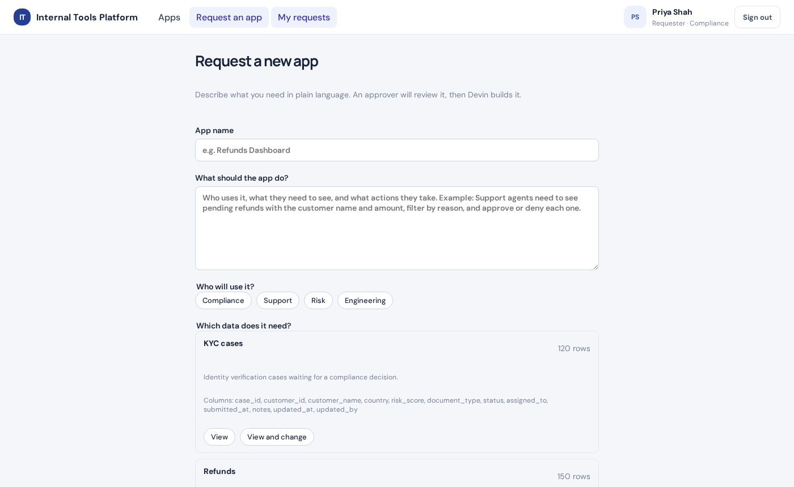
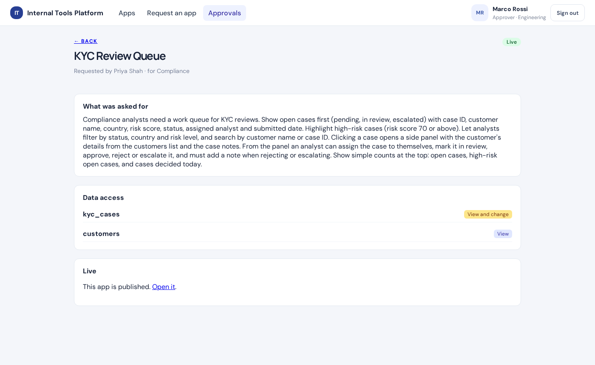
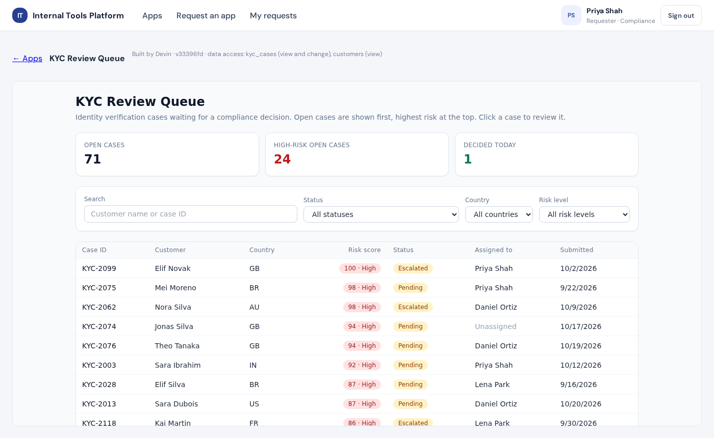
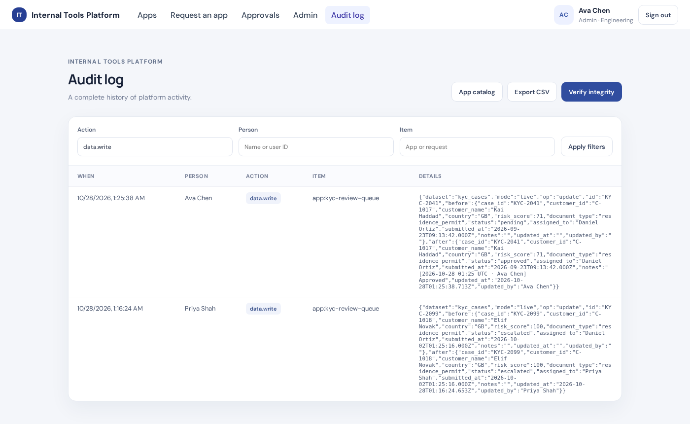

# Internal Tools Platform

A governed replacement for Power Apps: non-engineers describe an internal app in plain language, an approver signs off, Devin builds it, and the platform hosts it.



## How it works

1. **Request:** describe the app, who uses it and which datasets it needs.
2. **Approve:** an approver checks the request and its data access. Approving creates a private repo from the [app template](template/) and starts a Devin session.
3. **Build:** Devin builds the app and opens a PR. The approver previews it, merges the PR and publishes it.
4. **Use:** the app opens from the catalog for the teams it was published to.




## Roles

| Role | Can |
|---|---|
| Requester | Request apps and track them |
| Approver | Approve requests, preview builds, publish apps (never their own requests) |
| Admin | Everything above, plus registering existing apps, unpublishing apps and viewing the audit log |
| App user | Use live apps published to their team |

## Security

- Apps run in a sandboxed iframe with no network access and get data only through the platform, which checks the user, the team and the app's approved datasets.
- Every request, approval and data read or write goes into a tamper-evident audit log.



## Run it

```bash
npm ci
cp .env.example .env   # DEVIN_API_KEY, DEVIN_ORG_ID, GITHUB_TOKEN
npm run dev            # http://localhost:3000
```

To run it offline with Devin and GitHub mocked: `DEVIN_MOCK=1 GITHUB_MOCK=1 BUILD_MODE=local npm run dev`.

Tests: `npm test` and `npm run e2e`. Data is mock CSV files in `data/`. The design is in [docs/superpowers](docs/superpowers/).
